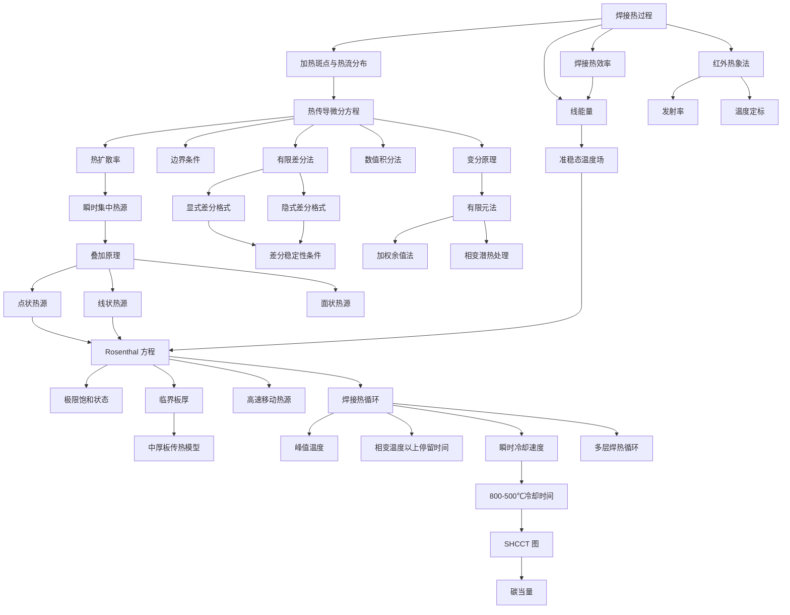

# 概念地图

> 按**逻辑依赖**而不是章节顺序排列。箭头方向 = "理解 B 需要先理解 A"。

## 主依赖图

## 六条主线（横向贯通）

### 主线 1：热从哪来

[[焊接热过程]] → [[焊接热效率]] → [[线能量]] → [[加热斑点与热流分布]]

> 核心问题：**给了多少热、怎么分布**。$E=q/v$ 是这条线的输出，也是后面一切的输入。

### 主线 2：热怎么传

[[热传导微分方程]] → [[边界条件]] → [[热扩散率]]

> 三个物性（$\lambda$、$c\rho$、$a$）与一个方程、一个边界条件。**没有边界条件就没有解。**

### 主线 3：解怎么来

[[瞬时集中热源]] → [[叠加原理]] → 点/线/面热源 → [[Rosenthal 方程]] → [[极限饱和状态]]

> 万能套路：先解"一瞬间点一下"，再叠加成"连续移动"。**三张基本解 + 一条叠加原理 = 整章 2。**

### 主线 4：板厚怎么判

[[临界板厚]] → [[中厚板传热模型]]

> 厚大焊件与薄板的公式形式完全不同（指数 vs $K_0$；$\omega\propto1/E$ vs $\propto1/E^2$），所以必须先判板厚。判据随材料、线能量、预热温度变化，不是一个固定数。

### 主线 5：组织怎么定

[[焊接热循环]] → [[峰值温度]] / [[相变温度以上停留时间]] / [[瞬时冷却速度]] → [[800-500℃冷却时间]] → [[SHCCT 图]] → [[碳当量]] → [[多层焊热循环]]

> 这条线是**传热与冶金的接口**：温度史 → 组织 → 硬度 → 裂纹倾向 → 工艺（预热、线能量、层间温度）。

### 主线 6：算不动怎么办

[[数值积分法]] / [[有限差分法]] / [[有限元法]]（[[变分原理]]、[[加权余值法]]）

> 三条路都在解同一个方程，区别是"离散什么"：积分点、节点、单元。共同的坑是**稳定性**与**相变潜热**。

## 概念对照表（最容易混的 12 组）

| 概念 A | 概念 B | 区别 |
|---|---|---|
| [[点状热源]] | [[线状热源]] | 三维 vs 二维；厚大 vs 薄板 |
| [[瞬时集中热源]] | 连续热源 | 一次给热 vs 持续给热（靠叠加原理转换） |
| [[准稳态温度场]] | 稳定温度场 | 场的形状不变 vs 温度真不变 |
| [[极限饱和状态]] | 饱和温度 $T_{op}$ | 状态 vs 该状态下的温度值 |
| [[峰值温度]] | [[瞬时冷却速度]] | 最高点 vs 下降速率 |
| [[800-500℃冷却时间]] | [[瞬时冷却速度]] | 区间积分平均 vs 瞬时值 |
| [[相变温度以上停留时间]] | $t_{8/5}$ | 高温待多久（晶粒） vs 多快冷（组织） |
| [[碳当量]] | 碳含量 | 折算指标 vs 成分分析值 |
| SHCCT 图 | CCT 图 | 峰值温度固定 vs 奥氏体化后任意冷却 |
| [[显式差分格式]] | [[隐式差分格式]] | 有条件稳定、易算 vs 无条件稳定、要解方程组 |
| [[变分原理]] | [[加权余值法]] | 泛函极值 vs 残差加权（数学出发点不同，结果可一致） |
| [[导热系数]] | [[热扩散率]] | 导热能力 vs 温度传播速度 |

## 三种"厚度"的物理含义

| 概念 | 含义 | 出现处 |
|---|---|---|
| 板厚 $h$（$\delta$） | 焊件几何厚度 | 全书 |
| [[临界板厚]] $h_{cr}$ | 板厚大到传热不再受厚度影响的分界 | §2-6、§3-3 |
| 热源有效半径 $r_H$ | 高斯热源的能量集中尺度（$r_H=\sqrt{3/K}$） | §1-2、§6-3 |

## 符号速查

| 符号 | 含义 | 单位（书中） |
|---|---|---|
| $q$ | 有效功率 | W |
| $E=q/v$ | 线能量 | J/cm |
| $\lambda$ | 导热系数 | W/(cm·℃) |
| $c\rho$ | 容积比热容 | J/(cm³·℃) |
| $a$ | 热扩散率 | cm²/s |
| $h$（$\delta$） | 板厚 | cm |
| $T_m$ | 峰值温度 | ℃ |
| $T_0$ | 初始/预热温度 | ℃ |
| $t_{8/5}$ | 800→500 ℃ 冷却时间 | s |
| $\omega_c$ | 冷却速度 | ℃/s |
| $K$ | 能量集中系数 | cm⁻² |
| $R$、$r$ | 距热源距离 | cm |

## 关联

- [[焊接传热学 MOC]]、[[公式总表]]、[[学习路径]]、[[术语中英对照]]