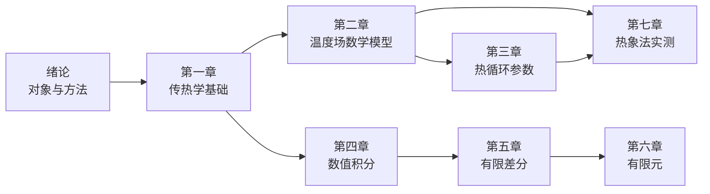

# 焊接传热学 MOC

> 张文钺《焊接传热学》结构化知识库。**175 页正文 + 7 页附表**，7 章 37 节，逐节笔记 + 原子概念卡 + 公式库，每条结论带原页链接。

## 快速入口

| 我要… | 去 |
|---|---|
| 系统学一遍 | [[学习路径]] |
| 查公式 | [[公式总表]]｜主线推导：[[从瞬时点热源到 t8-5 的推导链]] |
| 按概念跳转 | [[概念地图]] |
| 核对原文页码 | [[全书目录与页码对照]] |
| 中英术语 | [[术语中英对照]] |
| 手算查表（e⁻ˣ、erf、K₀、Ei） | [[附表函数表使用指南]] |
| 了解本库怎么做的 | [[关于本知识库]] |
| 查哪里有疑点、不可直接定量使用 | [[待校清单]] |

## 全书导航

### 绪论：研究对象与方法（p.1–3）
[[绪论 焊接传热学的研究对象与方法]] — 三条技术路线（解析 / 实验 / 数值）的分工，这是全书结构的由来。

### 第一章 金属焊接的传热学基础（p.4–26）
章笔记：[[第一章 金属焊接的传热学基础]]

| 节 | 内容 | 页 |
|---|---|---|
| [[§1-1 焊接热过程的特点]] | 局部集中、瞬时、运动 → 准稳态 | 4 |
| [[§1-2 焊接热源和焊接热效率]] | 热源分类、η、高斯热流 | 5 |
| [[§1-3 热传递的基本方式]] | 传导、对流、辐射 | 9 |
| [[§1-4 焊接温度场及其影响因素]] | 温度场、梯度、板厚判据、物性表 | 12 |
| [[§1-5 焊接传热计算基本公式]] | Fourier 定律、热传导方程 | 18 |
| [[§1-6 边界条件]] | 三类表面条件 | 20 |
| [[§1-7 瞬时集中热源作用下的温度场]] | 点/线/面三个基本解 | 21 |
| [[§1-8 表面散热和叠加原理]] | 散温系数、叠加原理 | 24 |

> 本章是地基。**§1-7 与 §1-8 是全书最重要的两节**：一个给"原子解"，一个给"组合规则"。

### 第二章 焊接温度场及其数学模型（p.27–55）
章笔记：[[第二章 焊接温度场及其数学模型]]

| 节 | 内容 | 页 |
|---|---|---|
| [[§2-1 厚大焊件连续焊接时的温度场]] | Rosenthal 点热源解（固定/移动） | 27 |
| [[§2-2 薄板焊接时的温度场]] | 线热源解，出现 $K_0$ | 30 |
| [[§2-3 细棒焊接时的温度场]] | 面热源解，一维 | 33 |
| [[§2-4 极限饱和状态时温度场的简化计算法]] | 工程最常用的简化式 | 34 |
| [[§2-5 加热及冷却阶段温度场的计算]] | 起弧/收弧、非稳态 | 37 |
| [[§2-6 中厚板焊接时的温度场计算]] | 临界板厚的处理 | 40 |
| [[§2-7 大功率高速移动热源的温度场计算]] | 高速焊近似 | 43 |
| [[§2-8 其他焊接方法的温度场]] | 脉冲焊、电渣焊、电阻焊 | 45 |

> 全书公式最多的一章。**§2-1、§2-4、§2-6** 是工程上真正会被用到的三节。

### 第三章 焊接热循环参数及其应用（p.56–83）
章笔记：[[第三章 焊接热循环参数及其应用]]

| 节 | 内容 | 页 |
|---|---|---|
| [[§3-1 焊接热循环的特征]] | 四个特征参数 | 56 |
| [[§3-2 焊接热循环参数的数学解析]] | $T_m$、$t_H$、$\omega$ 的解析式 | 58 |
| [[§3-3 冷却时间的计算及其影响因素]] | $t_{8/5}$、$t_{8/3}$、图解法 | 69 |
| [[§3-4 冷却时间与热影响区组织及硬度]] | SHCCT、硬度预测 | 74 |
| [[§3-5 多层焊焊接热循环]] | 长段/短段多层焊 | 79 |

> 工程上最"有用"的一章：给定材料+板厚+线能量，算峰值温度、t8/5、HAZ 硬度，据此定预热与层间温度。

### 第四章 焊接温度场的数值积分解法（p.84–93）
章笔记：[[第四章 焊接温度场的数值积分解法]]

| 节 | 内容 | 页 |
|---|---|---|
| [[§4-1 焊接温度场的数值解法]] | 三条数值路线概览 | 84 |
| [[§4-2 数值积分的一般概念]] | 梯形、Simpson、高斯求积 | 85 |
| [[§4-3 焊接温度场的数值积分解法]] | 焊接问题的具体实现 | 88 |

### 第五章 焊接温度场的有限差分解法（p.94–117）
章笔记：[[第五章 焊接温度场的有限差分解法]]

| 节 | 内容 | 页 |
|---|---|---|
| [[§5-1 用有限差分法解稳定热传导问题]] | 差商、Laplace 五点格式 | 94 |
| [[§5-2 用有限差分法解不稳定热传导问题]] | 四种格式、稳定性、边界离散 | 99 |
| [[§5-3 用有限差分法计算焊接热传导问题]] | 动坐标、局部细化、实例 | 110 |

> 稳定性判据（$f\le1/2$、$f\le1/4$）是本章必须背下来的东西。

### 第六章 焊接温度场的有限元解法（p.118–142）
章笔记：[[第六章 焊接温度场的有限元解法]]

| 节 | 内容 | 页 |
|---|---|---|
| [[§6-1 基于变分法的热传导问题有限元分析]] | 泛函→欧拉方程→单元矩阵 | 118 |
| [[§6-2 基于权余值法的热传导问题有限元分析]] | Galerkin、非线性方程 | 130 |
| [[§6-3 焊接温度场的数学模型]] | 薄板/厚板热源、假设 | 134 |
| [[§6-4 计算机程序的编制和实例分析]] | 框图、步骤、算例 | 138 |

### 第七章 热象法测定焊接温度场（p.143–168）
章笔记：[[第七章 热象法测定焊接温度场]]

| 节 | 内容 | 页 |
|---|---|---|
| [[§7-1 热象法概述]] | 红外辐射、探测器、成象 | 143 |
| [[§7-2 热象法测温原理及温度定标]] | 普朗克定律、灰度→温度 | 146 |
| [[§7-3 热象法测定焊接温度场装置]] | 光学系统、A/D 接口 | 152 |
| [[§7-4 热象法测定温度场]] | 图像处理、伪着色、实例 | 156 |

## 概念索引（按主题）

**热源与输入**：[[焊接热过程]]、[[焊接热效率]]、[[线能量]]、[[加热斑点与热流分布]]、[[瞬时集中热源]]
**温度场**：[[温度场与等温线]]、[[温度梯度]]、[[准稳态温度场]]、[[热传导微分方程]]、[[边界条件]]、[[叠加原理]]
**材料物性**：[[导热系数]]、[[容积比热容]]、[[热扩散率]]
**热循环**：[[焊接热循环]]、[[峰值温度]]、[[800-500℃冷却时间]]、[[瞬时冷却速度]]、[[相变温度以上停留时间]]、[[SHCCT 图]]、[[多层焊热循环]]
**热源模型**：[[点状热源]]、[[线状热源]]、[[面状热源]]、[[Rosenthal 方程]]、[[极限饱和状态]]、[[临界板厚]]、[[中厚板传热模型]]、[[高速移动热源]]
**数值方法**：[[数值积分法]]、[[高斯求积]]、[[有限差分法]]、[[显式差分格式]]、[[隐式差分格式]]、[[差分稳定性条件]]、[[变分原理]]、[[有限元法]]、[[加权余值法]]、[[相变潜热处理]]
**测试**：[[红外热象法]]、[[发射率]]、[[温度定标]]

## 全库统计

| 项 | 数 |
|---|---|
| 章笔记 | 8（含绪论） |
| 节笔记 | 35 |
| 概念卡 | 43 |
| 索引 / 术语 / 附表 / 公式库 | 9 |
| 合计 | 95 篇 |
| 正文覆盖 | 书 p.1–175（全部正文 + 附表说明） |
| 公式编号 | (1-1) … (6-x) |

---

> 📄 原书 PDF：[[焊接传热学 张文钺.pdf]]