> 📄 原文：[[焊接传热学 张文钺.pdf#page=122]]（书 p.118–142，全章）

# 第六章 焊接温度场的有限元解法

## 一句话

用变分法或权余值法把热传导方程化为节点温度的代数方程组，从而算任意形状焊件的温度场。

## 知识结构

```mermaid
graph TD
    A["第六章 有限元解法"] --> B["§6-1 基于变分法"]
    A --> C["§6-2 基于权余值法"]
    A --> D["§6-3 焊接温度场的数学模型"]
    A --> E["§6-4 程序编制与实例"]
    B --> B1["变分原理 / 欧拉方程"]
    B --> B2["单元离散 + 形函数"]
    B --> B3["单元变分 → 单元矩阵与载荷"]
    B --> B4["总体合成 → 整体方程组"]
    B --> B5["不稳定导热：空间有限元 + 时间差分"]
    B --> B6["轴对称问题"]
    C --> C1["余值 R 与加权积分"]
    C --> C2["加列金法 = 变分法（有泛函时）"]
    C --> C3["非线性：物性随温度变"]
    C --> C4["加权差分 θ 与稳定性"]
    C --> C5["直接迭代 / 变步长外推"]
    D --> D1["正态分布热源 q(r)=qm·exp(-Kr²)"]
    D --> D2["薄板：内部热源 + 上下表面散热"]
    D --> D3["厚板：单位厚度截面 + 边界热流"]
    D --> D4["熔化潜热：平均温度判据"]
    E --> E1["程序框图（变步长）"]
    E --> E2["离散化与 8 类输入数据"]
    E --> E3["实例：脉冲 TIG / 平板堆焊"]
```

节笔记：

- [[§6-1 基于变分法的热传导问题有限元分析]]（p.118–129）——泛函、欧拉方程、三角形单元、单元矩阵、总体合成、时间差分、轴对称
- [[§6-2 基于权余值法的热传导问题有限元分析]]（p.130–134）——余值加权、加列金法、非线性热传导、加权差分、两种非线性解法
- [[§6-3 焊接温度场的数学模型]]（p.134–137）——正态分布热源、物性与换热系数、熔化潜热、薄板与厚板模型
- [[§6-4 计算机程序的编制和实例分析]]（p.138–141）——程序框图、解题步骤、两个算例

## 核心结论（本章必须记住的 5–8 条）

1. **变分法 = 求泛函极值**。泛函的自变量是函数；泛函极值的必要条件满足欧拉方程。因此"解微分方程边值问题"与"求泛函极值"等价，这是有限元离散的合法性依据（p.118–120）。
2. **两种路线的分工**：能找到泛函时用变分法；找不到泛函时（如物性随温度变的非线性导热）用权余值法。加列金法是权余值法中精度最高的一种，**有泛函时与变分法结果相同**（p.130–131）。
3. **三种边界条件的性质不同**：给定温度是**强加边界条件**（必须事先满足），热流与换热是**自然边界条件**（由泛函极小化自动满足）。这是编程时"哪些要特殊处理"的唯一依据（p.125）。
4. **离散化的三步固定套路**：单元内温度线性插值 $T=[N]\{T\}^e$ → 单元变分得 $[K]^e$、$[C]^e$、$\{P\}^e$ → 按节点累加成 $[K]\{T\}=\{P\}$。$[K]$ 对称正定带状，可用半带宽存储（p.121–126、p.139）。
5. **不稳定导热必须双重离散**：空间用有限元、时间用差分。控制方程 $[K]\{T\}+[C]\{\partial T/\partial t\}=\{P\}$ 是一阶常微分方程组；时间格式（二点向后、C–N、加列金）各有稳定性条件，$\Delta t\propto(\Delta x)^2$（p.126–129）。
6. **非线性只改"矩阵的元素、不改形式"**：物性按分段线性 $\lambda=\lambda_0+\lambda_TT$ 进入积分号，于是 $[K]$、$[C]$、$\{P\}$ 都变成 $\{T\}$ 的函数，每步都要重算并重解（p.132–134）。
7. **有限元算得好不好，取决于数学模型而非算法**：热源用正态分布 $q(r)=q_m\exp(-Kr^2)$；薄板作内部热源并计上下表面散热；厚板取单位厚度截面、热源作边界热流或均布于焊缝截面；熔化潜热用单元平均温度判据、分摊到若干时间步（p.134–138）。
8. **实例验证**：脉冲 TIG 焊因高温停留时间短、焊缝多次熔化而降低纵向热裂纹倾向；8 mm 低碳钢平板堆焊的熔池尺寸与实测接近，$t_{8/5}\approx14.3$ s（p.140–141）。

## 核心公式

| 公式 | 含义 | 适用条件 | 来源 |
|---|---|---|---|
| $I(T)=\iint_R\frac{\lambda}{2}\left[\left(\frac{\partial T}{\partial x}\right)^2+\left(\frac{\partial T}{\partial y}\right)^2\right]dx\,dy+\int_{S_2}\alpha\left(\frac{T^2}{2}-T_eT\right)ds$ | 二维稳定导热的泛函 | 二维、稳态、无内热源、常物性 | p.121 |
| $N_i=\dfrac{1}{2A}(a_i+b_ix+c_iy)$ | 三角形单元形函数 | 单元内温度线性分布 | p.122 |
| $[K_1]^e=\dfrac{\lambda}{4A}\begin{bmatrix}b_i^2+c_i^2 & b_ib_j+c_ic_j & \cdots\\ \cdots & b_j^2+c_j^2 & \cdots\\ \text{对称} & \cdots & b_m^2+c_m^2\end{bmatrix}$ | 单元导热矩阵 | 任意三角形单元，与温度无关 | p.124 |
| $[K_2]^e=\dfrac{\alpha l_{jm}}{6}\begin{bmatrix}0&0&0\\0&2&1\\0&1&2\end{bmatrix}$，$\{P_2\}^e=\dfrac{\alpha T_el_{jm}}{2}\begin{Bmatrix}0\\1\\1\end{Bmatrix}$ | 边界换热矩阵与载荷 | **仅边界单元**、边界边为 $jm$ | p.124 |
| $[C]^e=\dfrac{\rho cA}{12}\begin{bmatrix}2&1&1\\1&2&1\\1&1&2\end{bmatrix}$ | 单元热容矩阵 | 不稳定导热 | p.127 |
| $[K]\{T\}+[C]\left\{\dfrac{\partial T}{\partial t}\right\}=\{P\}$ | 不稳定导热控制方程组 | 空间已离散、时间待离散 | p.127 |
| $\Delta t\le\dfrac{\rho c(\Delta x)^2}{4\lambda}$ | 加列金格式的步长上界 | 平面三角形网格、固定温度边界 | p.128 |
| $q(r)=q_m\exp(-Kr^2)$ | 电弧热源正态分布 | 电弧焊，$K=3/r_B^2$ | p.135 |
| $q_m=\dfrac{3Q}{\pi r_B^2}$（移动）／$q_m=\sqrt{\dfrac{3}{\pi}}\dfrac{Q}{lr_B}$（高速） | 最大比热流 | 按热源模型二选一 | p.135 |
| $Q=\dfrac{q(r)}{h}-\dfrac{2\alpha}{h}(T-T_e)$ | 薄板等效体积热源 | 温度沿厚度均匀 | p.137 |
| $[K_3]^e=\dfrac{\alpha A}{6h}\begin{bmatrix}2&1&1\\1&2&1\\1&1&2\end{bmatrix}$，$\{P_3\}^e=\dfrac{2\alpha T_eA}{3h}\begin{Bmatrix}1\\1\\1\end{Bmatrix}$ | 薄板上下表面散热附加项 | **每个单元**都要加 | p.137 |

## 工程含义

1. **有限元替代解析解的场景**：焊件几何复杂、有坡口/填角、物性随温度剧变、含相变、边界条件混合——这些情况 Rosenthal 类解析解全部失效，而有限元只需改模型参数。
2. **网格与步长是一对耦合参数**：$\Delta t\propto(\Delta x)^2$，加密网格必须同步缩小步长，否则振荡；实际计算用变步长（前期小、后期按 1.1～1.2 倍放大）。
3. **热源模型的选取直接决定热影响区宽度**：同一功率，高速热源模型的中心热流比移动热源模型高近一倍（$q_m$ 相差约 1.8 倍），熔合线位置随之变化。选模型必须与焊接速度匹配。
4. **薄板散热的量级**：板厚 $h$ 越小，$\frac{2\alpha}{h}$ 越大。就 $1/h$ 而言，0.5 mm 铝片比 8 mm 钢板大 16 倍，这就是薄板算例必须计入上下表面散热的原因（此外铝的 $\alpha$ 与钢也不同）。
5. **潜热不可省**：忽略熔化潜热会使熔池偏大、熔合线温度偏高；但潜热必须分摊到多个时间步，否则温度振荡。
6. **计算结果能直接服务工艺**：熔池尺寸 → 焊缝成形；近缝区热循环 → $t_{8/5}$ → 冷却速度 → 组织与硬度 → 选焊接参数。

## 易错点 / 常考辨析

- **变分法 vs 权余值法**：前者要求存在泛函，后者不要求。有泛函时加列金法与变分法等价；无泛函（非线性）时只能用权余值法。
- **强加边界 vs 自然边界**：给定温度必须事先满足（强加）；热流/换热边界由泛函极值自动满足（自然）。**记反了会以为换热边界不用处理**。
- **稳态 vs 不稳定的计算量**：稳态只解一次方程组；不稳定要从初始温度逐步推进，工作量大一个量级——这是变步长存在的理由。
- **$[K_1]$ 分母 $4A$，$[C]$ 前因子 $\rho cA/12$**：这两个系数最易记错，可用"行和 = 单元总量按节点均分"校核（$[C]$ 行和 $\rho cA/3$）。
- **三种时间格式的稳定性**：二点向后差分（大步长稳定、精度低）、C–N（精度高、$\Delta t$ 小否则衰减振荡）、加列金 $2/3$ 权重；加权差分法中 $\theta\ge1/2$ 无条件稳定、$\theta<1/2$ 有条件稳定。
- **移动热源 vs 高速热源**：前者对整个平面归一化（$q_m=3Q/\pi r_B^2$），后者对宽度 $l$ 的板条归一化（$q_m\approx0.977Q/(lr_B)$）。**同功率下高速热源的 $q_m$ 更大**。
- **厚板"二维化"的前提**：假定准稳态、热源沿焊缝同时作用。这会丢掉焊接速度的影响，书中明确说这是尚未完全解决的问题（p.137）。
- **潜热判据用单元平均温度**，不是节点温度；且判据比较的是"前一时刻 < 熔点 < 当前时刻"。

## 本章待校

- ⚠️ **p.128 式(6-91) 的系数**：OCR 作"$\Delta t\le\rho c(\Delta x)^2/64\lambda$"，分母中"9"与"64"无法分辨（原文串为 "CP（Ax）9/64"）。现按 64 录入，与式(6-95) 的 $4\lambda$ 相比大 16 倍，量级上更符合 C–N 格式"允许多倍于显式格式步长"的预期，但仍待核。
- ⚠️ **p.128 式(6-93)/(6-94) 加列金格式**：OCR 残缺，现按书中式(6-92) 的差分假设代入式(6-84) 还原；稳定性条件写作 $[K]-2[C]/(3\Delta t)\le0$。
- ⚠️ **p.129 式(6-105)～(6-110) 轴对称单元矩阵**：OCR 中前因子（如 $\lambda\bar r/4A$、$2\pi$ 因子）与矩阵元素大面积粘连，只保留结构与 $\bar r=(r_i+r_j+r_m)/3$ 的定义，系数未逐项恢复。
- ⚠️ **p.133 式(6-133)～(6-136) 非线性单元矩阵**：矩阵元素串行严重（如"$8_0+2(1,+70)$"），只保留结构；可用"$\lambda_T\to0$ 退化为常物性"与"行和自洽"两条判据还原。
- ⚠️ **p.141 表 6-1**：OCR 破损，仅确认 $\eta=70\%$、$\lambda=164.65$ W/(m·K)、$\rho c=2.68$ J/(cm³·℃)、$r_B=0.15$ cm 四项；表中"2600"一项与铝的熔点 660 ℃ 不符，未采用。
- ⚠️ **p.138 潜热分摊公式**：书中只给做法（"在若干时间步长内逐步加上去"）不给式子，§6-4 中的形式为整理所得。