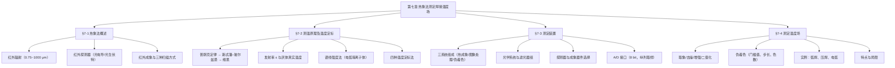

> 📄 原文：[[焊接传热学 张文钺.pdf#page=147]]（书 p.143–168，全章）

# 第七章 热象法测定焊接温度场

## 一句话

用红外热成象把焊件的热辐射变成灰度图象，再经温度定标把灰度翻译成温度场。

## 知识结构

节笔记：

- [[§7-1 热象法概述]]（p.143–145）——动态温度场的测量难题、红外辐射、探测器、成象与三种扫描方式
- [[§7-2 热象法测温原理及温度定标]]（p.146–151）——普朗克/斯忒藩–玻尔兹曼/维恩、发射率、谱线强度法、四种定标法
- [[§7-3 热象法测定焊接温度场装置]]（p.152–155）——三系统、滤光器组、探测器选择、A/D 接口
- [[§7-4 热象法测定温度场]]（p.156–167）——图象处理、伪着色、弧焊/压焊/电弧三类实例

## 核心结论（本章必须记住的 5–8 条）

1. **热象法要解决的是"动态、快速、强干扰"的测量难题**：焊接温度场变化率大、加热快、易受电弧辐射干扰，热电偶法测点有限、工作量大、不易准确（p.143）。
2. **物理链条是固定的五步**：温度 → 热辐射（普朗克、斯忒藩–玻尔兹曼、维恩）→ 红外辐射被探测器接收 → 扫描成象为灰度矩阵 → **温度定标**把灰度翻译成温度 → 伪着色显示。链条上任何一环不准（发射率、滤光片、定标条件），结果都不准（p.146–151）。
3. **式(7-3) 是测温的定量依据**：$M=\sigma_0T^4$ 把辐射能量与温度联系起来；灰体则 $M=\varepsilon\sigma_0T^4$，故辐射温度总是**低估**真实温度，须按 $T=T_a/\varepsilon^{1/4}$ 换算（p.147–148）。
4. **发射率是黑体理论通往实际焊件的唯一桥梁**，且不是常数：灰体近似为常数，**金属的 $\varepsilon$ 较低、随温度升高而增大（近似正比于热力学温度）**，抛光表面的 $\varepsilon$ 还与观察方向有关（p.148）。
5. **普朗克公式不适用于电弧**。电弧等离子体在热力学平衡（或局部平衡）且光学薄层时用**谱线强度法**：辐射强度只由温度决定，测强度即可反查温度（Ar I 7635 Å）（p.148）。
6. **温度定标的本质**：灰度值受波长、辐射能量、周围条件、时空因素、材料、距离、表面状态等多因素影响，**只有波长与辐射能量直接反映温度**；必须在**相对固定非温度影响因素**的条件下定标才有意义。四种工程定标法各有适用范围（p.148–151）。
7. **装置设计的三处关键**：滤光器组（只留红外窗口波段、兼顾探测器响应）、探测器（**选长波灵敏**以避开电弧强辐射）、A/D 接口（8 bit、纵列取样、3 s/帧）（p.152–155）。
8. **实测结论**：脉冲 TIG 焊高温停留时间短、焊缝多次熔化→降低纵向热裂纹倾向；对焊温度分布均匀程度为"预热闪光 > 连续闪光 > 电阻对焊"；点焊飞溅会改变热传导、可据此监控质量；电弧弧柱温度与截面随电流增大，但轴向高温区在 150 A 以上向阳极迁移（p.161–167）。

## 核心公式

| 公式 | 含义 | 适用条件 | 来源 |
|---|---|---|---|
| $M_\lambda=\dfrac{C_1\lambda^{-5}}{\exp(C_2/\lambda T)-1}$ | 普朗克定律（黑体光谱辐射） | 固体/黑体；不适用于电弧等离子体 | p.147 |
| $M=\sigma_0T^4$ | 斯忒藩–玻尔兹曼定律 | 全波段、半球空间 | p.147 |
| $\lambda_mT=2896\sim3000\ \mu\mathrm m\cdot\mathrm K$ | 维恩位移定律 | 选滤光片、估算峰值波长 | p.147 |
| $M_{\lambda m}=b'T^5$ | 峰值光谱辐射出射度 | 同上 | p.147 |
| $M=\varepsilon\sigma_0T^4$ | 灰体辐射 | 灰体（$\varepsilon$ 与波长无关） | p.147 |
| $T=T_a/\varepsilon^{1/4}$ | 由辐射温度换算真实温度 | 灰体；$\varepsilon<1$ 故 $T>T_a$ | p.148 |
| $I_{mn}=\dfrac{hc}{4\pi\lambda_{mn}}A_{mn}\dfrac{g_mN}{Z}\mathrm e^{-E_m/kT}$ | 谱线强度（电弧测温） | 热力学平衡、光学薄层 | p.148 |
| $V=F K\dfrac{\varepsilon}{\varepsilon'}R_\lambda\tau\,\sigma_0T^4\dfrac{A_1A_2}{\pi r^2}$ | 刻度方程 | 形状系数 $F$ 固定、接收元件按灰体 | p.149–150 |
| $T_2=T_1/\varepsilon^{1/4}$ | 黑体炉分度表换算灰体温度 | 输出电平相等 $V(T_2)=V(T_1)$ | p.150 |
| $L=L_m+KL_a$ | 正面取象的总辐射亮度 | 存在电弧反射干扰 | p.154 |
| $A_i=\dfrac{1}{8+k}\left(\sum_{n=1}^{8}Q_{in}+ka_i\right)$ | 加权模块去噪声 | $k$ 取 1～2 | p.158 |
| $X=nx-m$ | 线性灰度增强 | 恒域处理 | p.159 |
| $I(x)=2\displaystyle\int_x^R\dfrac{\varepsilon(r)r\,dr}{\sqrt{r^2-x^2}}$，$\varepsilon(r)=-\dfrac{1}{\pi}\displaystyle\int_r^R\dfrac{\mathrm dI/\mathrm dx}{\sqrt{x^2-r^2}}\mathrm dx$ | ABEL 变换与反演 | 轴对称、光学薄层（电弧） | p.166 |

## 工程含义

1. **热电偶与热象法互补**：热电偶给出精确的时间历程（单点定性好、可作定标基准），热象法给出全场瞬时分布（空间信息全、但需定标）。书中三种实例里，监视热电偶法正是用热电偶给热象"打标"，误差 <2%。
2. **电弧是"必须绕开"的干扰源**：可见光区电弧与熔池辐射相差约 $1.5\times10^5$ 倍，红外窗口两者接近——所以测焊接温度场一定要**用红外波段 + 长波灵敏探测器**，并且尽量**从反面取象**。
3. **滤光片 = 量程**：每块滤光片对应一段线性温区（IRN01 用于 600～900 ℃、IRN02 用于 900～1200 ℃）。换温区必须换片并重新定标，不能一片通吃。
4. **伪着色是"温度可视化"而非美化**：颜色与温度的对应靠门槛值、步长、色数三个参数；一旦参数改动，图与温度的对应关系必须重新给出。
5. **实时性受接口限制**：A/D 纵列取样使一幅 $256\times256$ 图象取入内存需约 3 s，所以现场只能"录下来、离线处理"。这也是本章末尾所说"处理速度还难以满足实时监测"的具体来源。
6. **可与数值计算互相验证**：第六章有限元算出的熔池形状、热循环曲线，正是热象法能实测的量——实测与计算对照是校核数学模型的标准做法。

## 易错点 / 常考辨析

- **热象法 vs 热电偶法**：热电偶接触式、单点、精度高、响应慢（有热惯性）；热象法非接触、全场、快速，但依赖发射率与定标。**不是替代关系，是互补关系**。
- **辐射温度 vs 真实温度**：$T_a$ 是假定 $\varepsilon=1$ 反算出来的，恒低于真实温度；$\varepsilon=0.3$ 时真实温度约为辐射温度的 1.35 倍。
- **黑体辐射公式 vs 谱线强度公式**：前者用于固体表面（焊件），后者用于气体等离子体（电弧）。**对电弧用普朗克公式是根本性错误**。
- **维恩位移定律的用途**：用来**选波段**（估算峰值波长），不是用来测温；测温靠式(7-3) 或式(7-13)。
- **定标法与对象要配对**：工件温度场可用黑体炉/定标器/监视热电偶；电弧温度场只能用**钨带灯**（因为电弧不是灰体表面辐射）。
- **去噪声与保边的权衡**：$k$ 小去噪强但模糊，$k$ 大保边但残留噪声；书中建议先用 $k=1$，若图象失真再改 $k=2$。
- **对焊三种方法的均匀性排序易混**：电阻对焊最不均匀（回路内外阻抗差大），预热闪光最均匀，连续闪光居中。

## 本章待校

- ⚠️ **p.161 维恩公式算例**：原文给出 $T=1200\ ℃$ 时 $\lambda_m=1.74\ \mu\mathrm m$，但按式(7-6)（$\lambda_mT=2898\ \mu\mathrm m\cdot\mathrm K$，$T=1473$ K）应为 **1.97 μm**；同页 $T=650\ ℃\to3.14\ \mu\mathrm m$ 与 $T=1800\ \mathrm K\to1.6\ \mu\mathrm m$（p.154）均与 2898 吻合，故判 1.74 为误读/OCR 错误。
- ⚠️ **p.148 式(7-9) 谱线强度公式**：OCR 几乎全损（只剩 $hc$、$E_m$、$A_{mn}$、$g_m$、$Z$ 等符号），现按"玻尔兹曼分布 + 爱因斯坦跃迁几率"的标准形式整理，符号表与书中一致但系数位置待核。
- ⚠️ **p.149–150 式(7-13) 刻度方程**：OCR 为残串，现按物理链条（形状系数 × 转换系数 × 黑度比 × 光谱灵敏度 × 透过率 × 斯忒藩–玻尔兹曼项 × 几何因子）整理，乘积结构可靠、个别因子归属待核。
- ⚠️ **p.143 红外波段频率下限**：正文给 $4\times10^{11}$ Hz，而按 $\lambda=1000\ \mu\mathrm m$ 计算为 $3\times10^{11}$ Hz，属波段划分约定差异。
- ⚠️ **p.154 表 7-1**：6000 K 一行 OCR 作"99.5 / 0.05"（两项和 99.55），疑为 99.95 / 0.05；表头单位与数值不符，数值应为**百分比**。
- ⚠️ **p.161 脉冲 TIG 参数**：脉冲频率 OCR 作"8333 Hz"，从焊机实际能力与脉宽比 50% 判断，疑为 **8.33 Hz**，未采用具体数值。
- ⚠️ **p.164 表 7-5、7-6（对焊设备与规范）**：OCR 严重破损（如"6250～9955"、"顶锻压力/N•四立一"），仅采用可确认的方法名、材料（20# 钢 $\phi20$ 棒料）、设备（LP-75 接触焊机）与总伸出长度 30 mm。